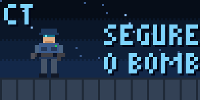

<p align="center">
  
</p>

<h1 align="center">C4 Timer para Ulanzi D200</h1>

<p align="center">
  O tempo da C4 do Counter-Strike 2 nas teclas do seu deck, em pixel art 8-bit.<br>
  <a href="https://murar0.github.io/cs2-c4-timer/"><b>Página e manual</b></a> ·
  <a href="https://github.com/murar0/cs2-c4-timer/releases/latest/download/com.ulanzi.cs2c4.ulanziPlugin.zip"><b>Baixar</b></a> ·
  <a href="https://www.tiktok.com/@mur4r0">TikTok</a>
</p>

---

| Cor | Quando | Aviso |
| --- | --- | --- |
| Verde | 10s ou mais | DÁ SEM KIT |
| Amarelo | Entre 10s e 5s | SÓ COM KIT |
| Vermelho | Menos de 5s | SEM TEMPO |

* Tecla única ou tecla larga (duas teclas vizinhas viram uma tela só).
* Animações 8-bit do seu lado (TR ou CT), explosão, defuse e uma estrela cadente de vez em quando.
* A contagem vai para o deck como animação, então a tecla não pisca.
* Usa a Game State Integration oficial do CS2: sem leitura de memória, sem injeção, tudo local.

## Instalação rápida

1. Baixe o [ZIP da versão mais nova](https://github.com/murar0/cs2-c4-timer/releases/latest/download/com.ulanzi.cs2c4.ulanziPlugin.zip) e extraia.
2. Feche o Ulanzi Studio e copie a pasta `com.ulanzi.cs2c4.ulanziPlugin` para `%APPDATA%\Ulanzi\UlanziDeck\Plugins`.
3. Abra o Ulanzi Studio e arraste **Timer da C4** para uma tecla (ou duas vizinhas).
4. Clique na tecla, aperte **Instalar no CS2** e reinicie o jogo.

O passo a passo com imagens, como funciona e a explicação de por que achamos que não dá ban estão na [página do projeto](https://murar0.github.io/cs2-c4-timer/).

## Aviso

Gamers Club, FACEIT e campeonatos têm regras próprias e podem proibir programas externos ou cronômetros da C4. Confira antes de usar lá. Projeto independente, sem ligação com a Valve ou a Ulanzi.

Este projeto é gratuito e foi publicado para incentivar a comunidade a ser criativa e a se ajudar. **O autor não se responsabiliza, de nenhuma maneira, por banimentos, punições ou qualquer outra consequência do uso.** A responsabilidade é inteiramente de quem decidir usar.

## Estrutura do repositório

```
com.ulanzi.cs2c4.ulanziPlugin/   o plugin (veja o README de dentro para detalhes técnicos)
docs/                            a página do GitHub Pages
site/                            fonte da página (rode site/build.sh para gerar docs/index.html)
```

## Créditos

Criado por **Felipe Muraro**, [@mur4r0 no TikTok](https://www.tiktok.com/@mur4r0). Licença MIT. O SDK da Ulanzi incluído segue a licença Apache 2.0.
